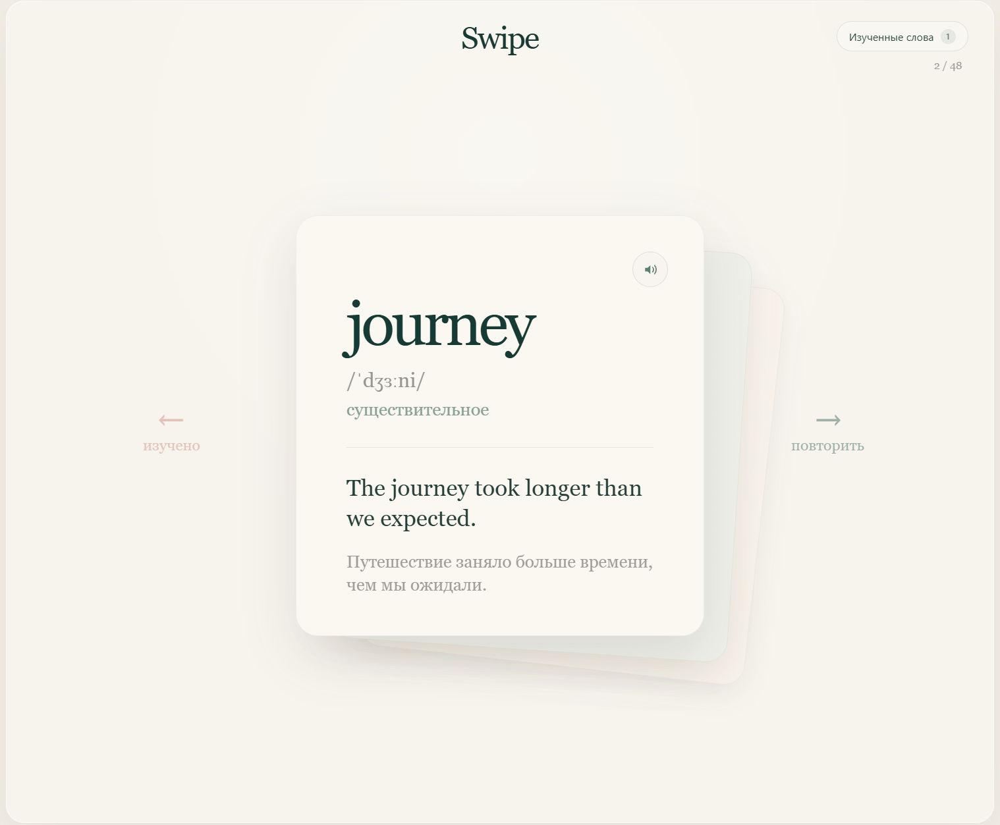
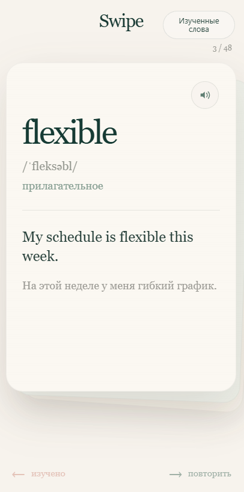

# Swipe

Минималистичное веб-приложение для изучения слов с помощью свайп-карточек.

Карточки идут одна за другой: слово можно отправить в изученные свайпом влево или вернуть на повторение свайпом вправо. Интерфейс намеренно оставлен максимально простым — без разделов, уровней и лишней навигации.

### [Открыть демо →](https://swipe-eosin.vercel.app/)

## Превью

### Desktop



### Mobile



## Возможности

- свайпы карточек мышью и пальцем;
- свайп влево — слово изучено;
- свайп вправо — вернуть слово на повторение;
- список изученных слов;
- возврат изученного слова обратно в очередь;
- произношение слова;
- пример использования и перевод;
- отображение прогресса;
- сохранение состояния между сессиями;
- адаптивный интерфейс для desktop и mobile.

## Стек

- Vue 3
- Vite
- JavaScript
- CSS
- LocalStorage
- Web Speech API

## Запуск локально

```bash
git clone https://github.com/wakukiku/swipe.git
cd swipe
npm install
npm run dev
```

Для production-сборки:

```bash
npm run build
```

## Идея

В основе Swipe — максимально короткий путь между открытием приложения и изучением слова.

Без выбора режима или колоды: пользователь сразу попадает к карточкам и взаимодействует с ними привычным жестом свайпа.

---

**Live:** [swipe-eosin.vercel.app](https://swipe-eosin.vercel.app/)
